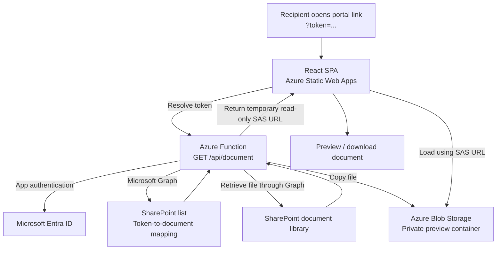

# Document Portal - Azure Architecture Summary

## Purpose

Provide a branded, browser-based document portal where a recipient opens a token-based link to preview or download a document held in SharePoint, without signing into SharePoint directly.

The React SPA provides the user interface. The Azure Function resolves the token against a SharePoint list, retrieves the associated file through Microsoft Graph, copies it into Azure Blob Storage, and returns a read-only SAS URL valid for 15 minutes.

For the POC, `GET /api/document/content?token=...` offers an alternative response:
the same lookup and retrieval return raw file bytes with inline disposition and
an extension-based MIME type, without a Blob upload or SAS URL. The SPA continues
to use the original `/api/document` route. See the [deployment guide](Azure-Deploy-Guide.md#poc-inline-content-endpoint)
for supported MIME types and browser limitations.

## High-level flow

## Components for the Azure team

| Component | Purpose / provisioning requirement |
|---|---|
| Resource Group | Group the document portal resources. |
| Azure Static Web Apps | Host the React SPA over HTTPS. App Service or Storage static hosting are alternatives, not additional requirements. |
| Azure Function App + hosting plan | Host the document resolver API. Current code uses Functions v4, .NET 8 isolated. |
| Azure Storage Account | Provide Function runtime storage and Blob Storage for document copies. These can share an account initially or be separated according to policy. |
| Private Blob container | Create `document-preview-cache`. Access to document copies is via temporary SAS URLs, not anonymous container access. |
| Microsoft Entra app registration | Allow the Function to access SharePoint through Microsoft Graph using application permissions, admin consent, and appropriate site access. Current implementation uses a client secret. |
| Azure Key Vault (recommended) | Store the Graph client secret and storage connection string; expose through Function app-setting references using a managed identity. |
| Application Insights (recommended) | Configure Function monitoring, failures, and alerting. |

**Existing Microsoft 365 dependencies:** a SharePoint site, token-to-document mapping list, and document library.

## Configuration and deployment considerations

- **SPA:** set `VITE_FUNCTION_BASE_URL` to the Function's `/api` URL before building.
- **Function:** configure SharePoint tenant/client credentials, site/list IDs, storage connection strings, and container name.
- **Connectivity:** configure Function and Blob CORS for the SPA origin. Office previews may use Microsoft's external Office viewer, so the SAS URL must also be reachable by that service.
- **Production controls:** agree token issuance, expiry/revocation, and Blob cleanup policy. The current 15-minute expiry applies to the SAS URL, not the original portal token, and does not delete the copied file.

**Scope note:** this repository implements the viewing/resolution path; issuing and distributing token links is outside the current SPA/Function flow.
